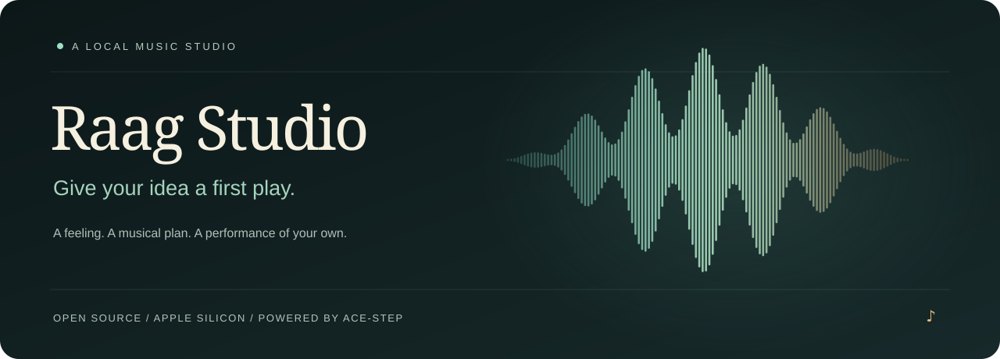
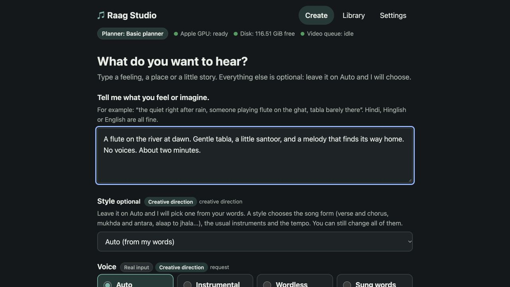
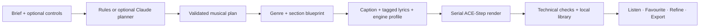

<p align="center"></p>

<p align="center">
  <strong>You bring the feeling. Your Mac brings the music.</strong><br>
  An open-source music studio that turns a brief into a musical plan, a performance and a library of your own.
</p>

<p align="center">
  <a href="https://github.com/siddhant68/raag-studio/actions/workflows/tests.yml"></a>
  <a href="LICENSE"></a>
  
  
  
</p>

<p align="center">
  <a href="#hear-it-first">Hear it</a> · <a href="#your-idea-has-a-plan">Explore the controls</a> ·
  <a href="#get-started">Get started</a> · <a href="docs/CONFIGURATION.md">Configuration guide</a> ·
  <a href="CONTRIBUTING.md">Contribute</a>
</p>

## The prompt is your instrument

> “A flute on the river at dawn. The tabla waits its turn. A melody that finds its way home.”

> “A small midnight jazz café. Saxophone up front, Rhodes answering, brushes keeping it alive.”

> “A Hindi duet about finding home in another person. Two perspectives, one returning chorus.”

Write what you hear in your head. Raag Studio gives it a structure: a lead, an ensemble, a pace, a voice,
and a journey from the first phrase to the last. You can inspect those decisions, change them, make a few
takes, keep your favourites and export the result.

The required input is **one brief**. Everything else can stay on Auto.

## Hear it first

These are real local ACE-Step renders from a fixed twelve-brief showcase. Each brief was rendered once;
the full set is included so you can hear the range for yourself.

| A place to begin | What to listen for | Play |
| --- | --- | --- |
| **River waking up** | Bansuri lead, space, ornament and a returning idea | [▶ Instrumental](showcase/diverse12_2026-10-25/audio/01_river_waking_up_bansuri_instrumental.mp3) |
| **Midnight café** | Saxophone, Rhodes, upright bass and brushes | [▶ Jazz](showcase/diverse12_2026-10-25/audio/02_midnight_cafe_jazz_sax_instrumental.mp3) |
| **थोड़ी देर और** | Intimate Hindi male vocal and a rising chorus | [▶ Hindi ballad](showcase/diverse12_2026-10-25/audio/05_thodi_der_aur_hindi_male_ballad.mp3) |
| **My Own Sunrise** | Female soul-pop, phrasing and backing harmonies | [▶ Soul-pop](showcase/diverse12_2026-10-25/audio/09_my_own_sunrise_english_female_soul_pop.mp3) |

**[Listen to all twelve →](showcase/diverse12_2026-10-25/README.md)** ·
[Open the playlist](showcase/diverse12_2026-10-25/listen_all.m3u)

The batch produced **24:30 of music in 7:08**, including checks and listening-copy preparation, on an M5 Pro
MacBook Pro with 48 GB unified memory. Engine subprocess time totalled 5:41. This is one recorded run, not a
speed guarantee or a comparison against other models. Track 4 has a quiet-duration warning; musical ratings
remain open. [Measurements and settings](showcase/diverse12_2026-10-25/manifest.json).

## Your idea has a plan

Raag Studio translates intent into a validated configuration before it asks the model to perform.
The plan records where a decision came from: **you, a preset, a rule or a planner suggestion**.

| Shape the music | What you can choose |
| --- | --- |
| **Style and vocabulary** | 38 presets, from Hindustani bansuri and ghazal to cinematic orchestral, jazz, rock, soul and EDM; 56 named instruments |
| **The ensemble** | A lead with simple, singing or ornate playing; supporting instruments with rhythm, drone, harmony, answer or texture roles and sparse/gentle/full presence |
| **Time and movement** | 10–240 seconds, 60–140 BPM, major/minor key targets and 4/4, 3/4, 6/8 or 2/4 meter |
| **Arrangement** | Spare, balanced or full; steady, slow build or a quiet middle bloom; genre-aware section maps with verses, choruses, bridges, solos, builds and drops |
| **The human part** | Instrumental, wordless or sung; male/female/duet requests; language; light harmonies, choir or larger choir direction |
| **The words** | Your lyrics preserved as supplied, or optional Claude songwriting with section-aware drafting and lyric checks |
| **The next version** | 1–4 takes, favourites, another performance, quick refinement chips and optional natural-language changes |
| **The engine** | Classic or shift3 turbo profiles; optional 5Hz LM and XL profiles when separately installed; exact seeds and request receipts |

The browser exposes the everyday choices. The structured plan and API expose the detailed musical vocabulary;
they are documented separately so a field in the plan is never mistaken for a dedicated UI knob.

**[See every customization, its range and what it actually controls →](docs/CONFIGURATION.md)**

### A small example of musical intent

“Let the flute lead” becomes a lead assignment. “The tabla should stay out of the way” becomes sparse rhythm
support. A bansuri preset supplies an alaap → pulse → theme → development → cadence journey. A romantic song
gets a different form, vocal language and lyric structure. Tempo and duration help fit the planned sections.

The compiler then prioritizes that plan into a compact caption and separately tagged lyrics. Conflicting or
dropped instructions are reported. Instruments, groove, sections and singer separation remain **performance
targets**: the audio model can miss them, and listening is how you judge the result.

## A session you can keep

- **Create, listen, compare.** A local browser interface, playable takes, favourites, a persistent library and MP3/WAV export.
- **See the reasoning.** Inspect the plan, song map, provenance, compiled caption and exact engine request.
- **Keep the originals.** New takes become new performances; favourites and previous audio stay intact.
- **Render with care.** One heavy job at a time, resource checks, cancellation, durable job state and technical audio checks.
- **Choose your planner.** Basic rules run locally by default. Claude CLI or API planning is optional and visibly labelled.
- **Keep music local.** With models installed, Basic planning and audio generation use your computer. Optional Claude planning sends text to Anthropic.

<p align="center"></p>

## Get started

Real audio generation currently targets **macOS on Apple Silicon** with an MPS-capable ACE-Step installation.
The validated machine has **48 GB unified memory**. Smaller-memory Macs have not been validated for this setup.
Python 3.12, Git and FFmpeg/FFprobe are required. The interface has no npm build step.

```sh
git clone https://github.com/siddhant68/raag-studio.git
cd raag-studio
brew install python@3.12 ffmpeg
./scripts/setup.sh
```

Install the pinned local engine and core weights explicitly:

```sh
python3.12 scripts/setup_engine.py --yes
export RAAG_TOOLS_DIR="$PWD/runtime"
python3.12 scripts/preflight.py --json
./scripts/start.sh
open http://127.0.0.1:8477
```

Already have the compatible engine? Set `RAAG_TOOLS_DIR` to your existing tools folder instead; the app uses it
read-only. `setup.sh` installs only the app. `setup_engine.py --yes` is the separate, opt-in multi-GB download.
Stop the app with `./scripts/stop.sh`.

**[Installation, engine layout and troubleshooting →](docs/INSTALLATION.md)**

## How a sentence becomes a session



The app is FastAPI + SQLite + browser-native JavaScript. The engine lives in a separate Python environment.
Every real take retains its seed, request, effective settings, native audio and engine result.
[Architecture](docs/ARCHITECTURE.md) · [API](docs/API.md) · [Development](docs/DEVELOPMENT.md).

## Where this release stands

This is an **early-access local application** with real rendered examples and regression tests. Hindi diction,
duet separation, lyric delivery and exact musical adherence still need human evaluation. Prompted instrument
presence is not a stem mixer; refinement creates a new performance rather than a sample-exact edit.

The current harness supports text-to-music on Apple Silicon. Score/MIDI editing, independent instrument faders,
voice cloning and hosted multi-user deployment are outside this release. The optional LM and XL profiles are
integrated but were not used in the included showcase. Shift3 is the song-pipeline default; the showcase does
not establish that it is universally better than classic.

The public packaging preserves the working musical pipeline and includes twelve fixed-plan request regression
checks. [Release validation](docs/RELEASE_VALIDATION.md).

## Build the next verse

Useful contributions include clearer onboarding, accessibility, Hindi/English lyric delivery evaluation,
better measured presets, and new engine/platform support with reproducible evidence.

Read [CONTRIBUTING.md](CONTRIBUTING.md), browse the [roadmap](docs/ROADMAP.md), or
[open an issue](https://github.com/siddhant68/raag-studio/issues). Please use private reporting for security
issues: [SECURITY.md](SECURITY.md).

## Credits and license

Created by **Siddhant Pathak**. Music powered by **[ACE-Step 1.5](https://github.com/ace-step/ACE-Step-1.5)**;
Apple acceleration uses PyTorch MPS and MLX. Optional text planning uses Claude.

Application code: **[MIT](LICENSE)**. Engine weights, third-party dependencies and generated-output rights are
documented separately in [NOTICE.md](NOTICE.md). No engine weights or private user library are bundled.
